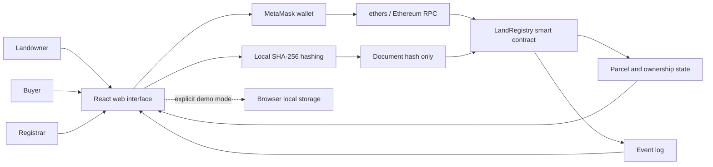

# Blockchain based land registry system

Mini Project CSE7102 · Project ID 109

## Problem statement

The supplied Review-2 presentation identifies document tampering, duplicate ownership records, slow verification and fraudulent transactions as problems in conventional land administration. This prototype records parcel claims and approved ownership changes in an Ethereum smart contract, with a wallet-based interface for claimants, buyers and registrars.

## Requirements coverage

| Presentation expectation | Implementation |
|---|---|
| Secure digital registration | Signer-bound registration with validated metadata and document hash |
| Unique blockchain ownership records | Permanent unique canonical parcel-code mapping |
| Ownership/document verification | Independent registrar review and local SHA-256 comparison |
| Buying/selling or ownership transfer | Owner proposal, buyer consent, registrar finalization; payment excluded |
| Transparency and tamper resistance | Contract state and emitted events, with JSON export |
| HTML, CSS, JavaScript | React/Vite application with custom CSS |
| Ethereum / Polygon | Local Ethereum-compatible Hardhat chain; Polygon deployment not configured |
| Hardhat / Truffle, MetaMask | Hardhat node, installed solc compiler, ethers and MetaMask extension |

The provided presentation's proposed-solution paragraph duplicates the problem statement. This report supplies the actual implemented design. No claims of improved performance, fraud reduction percentages or legal acceptance have been measured or invented.

## Architecture

Original document bytes stay on the user's device. MetaMask controls signing. Contract calls perform authorization using msg.sender, not a client role selector. The selector exists only in demo mode. The application does not use a centralized database in blockchain mode.

## Data model

Each parcel stores an ID, canonical survey code, location, integer area in square metres, category, SHA-256 document hash, owner, review status, dispute flag, proposed buyer and buyer consent flag. A unique-code mapping prevents duplicate identifier registration. Registrar permissions are a separate mapping; the deploying address remains administrator.

## State transitions

Pending claims become Verified or Rejected through registrar review. Verified, undisputed parcels can enter a transfer proposal. Buyer acceptance does not change ownership. Finalization by an independent registrar changes the owner and clears proposal state. Either party can cancel. A dispute cancels any existing proposal and blocks subsequent transfers until resolved. Rejected records stay in the system for auditability.

## Access controls

- Claimant identity comes from the signing wallet.
- Only the current owner proposes a transfer.
- Only the named buyer accepts it.
- Only registrars review claims, adjudicate disputes and finalize transfers.
- Registrar review and dispute adjudication require an account other than the owner.
- Transfer finalization requires a registrar who is neither owner nor buyer.
- Only the administrator changes registrar permissions.

## Evaluation

`npm test` uses a real isolated Hardhat EVM and the compiled Solidity bytecode. Cases cover registration, invalid metadata, duplicate codes, role checks, self-approval, rejected claims, transfer consent, cancellation, independent finalization, disputes and role revocation. UI build verification is separate from contract behavior. Manual MetaMask approval remains a user step.

## Limitations and future work

The system cannot infer legal title, verify identity, detect overlapping boundaries, or validate external documents by itself. Those decisions remain with the registrar and source authorities. Production work includes authoritative cadastral identifiers, authenticated off-chain evidence storage, encryption/privacy controls, registrar governance and recovery, appeals and corrections, payment/escrow integration, pagination and an event indexer, and an independent security audit. Local development data is intentionally disposable.

## Presentation discussion points

1. Explain why immutable events preserve a verifiable change history but do not make an incorrect initial claim true.
2. Demonstrate the three roles and show authorization failures from direct contract calls in the tests.
3. Explain why hashing files is different from uploading them to IPFS or a document database.
4. Show why buyer consent and independent registrar approval both precede the ownership change.
5. Explain the difference between duplicate survey codes and duplicate physical land claims.
6. Describe deployment, governance and legal integration as remaining production requirements.
